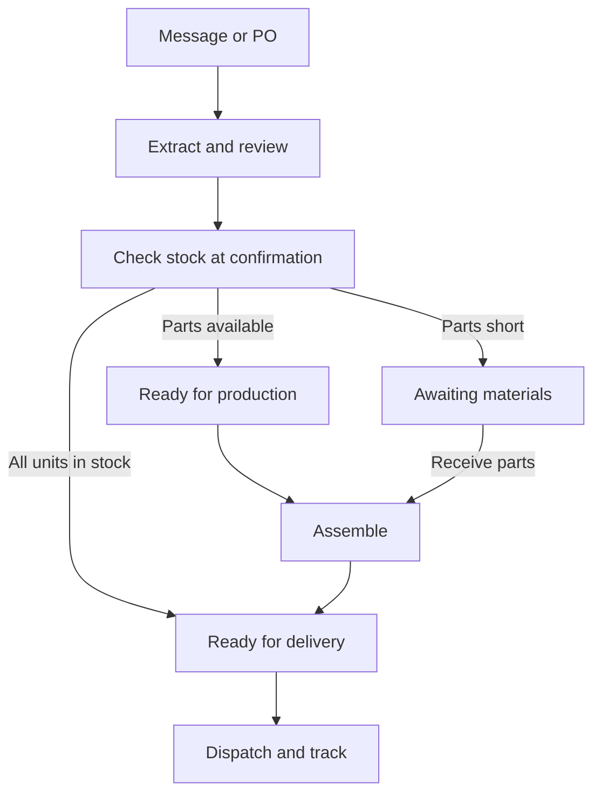
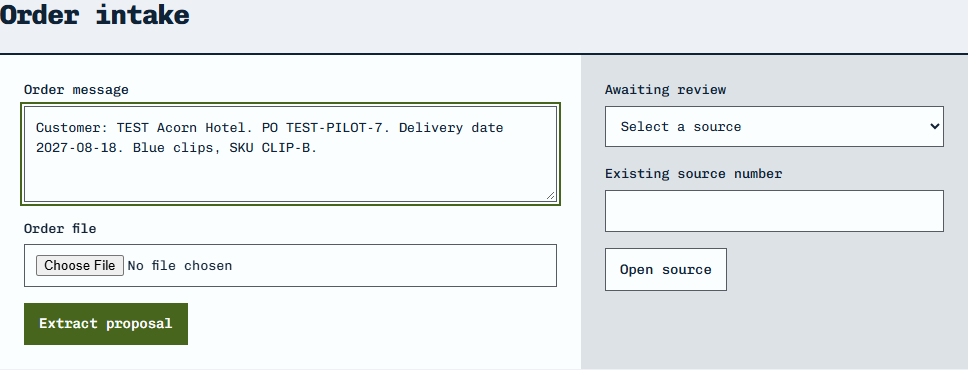
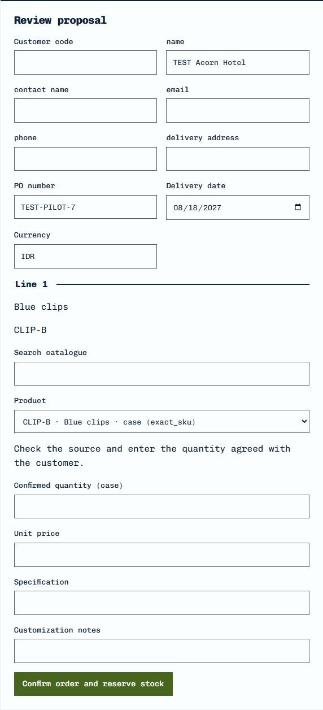
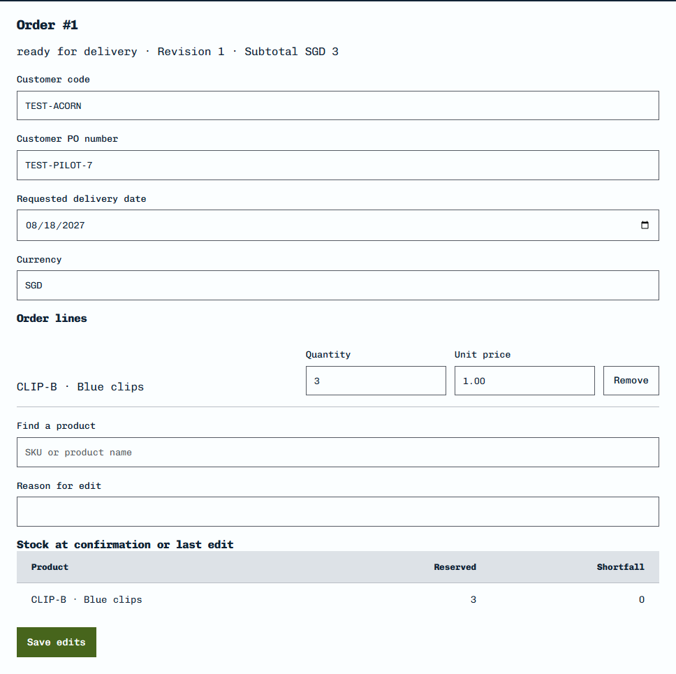
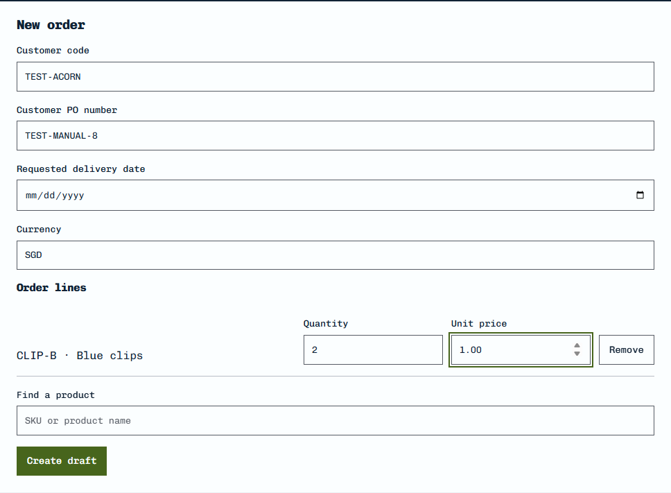
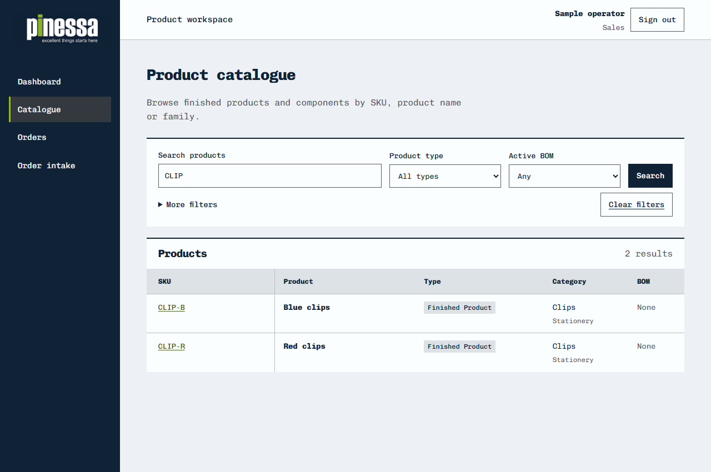
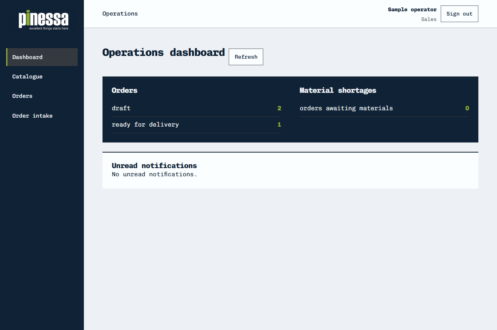
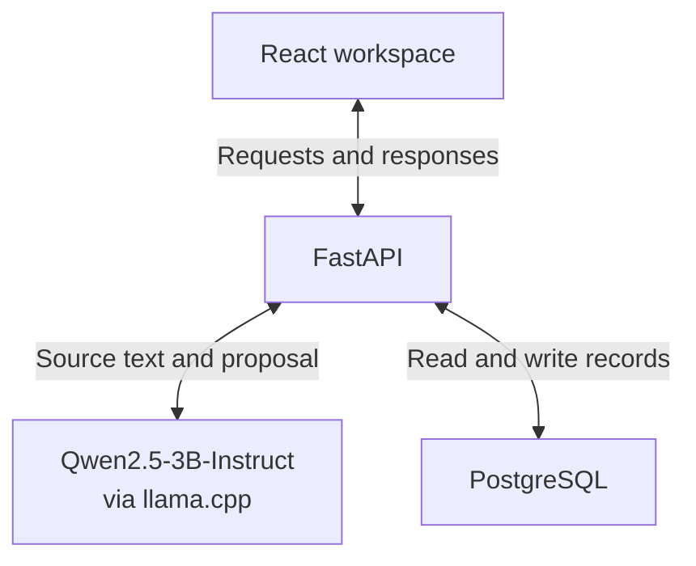

# 📦 Pinessa Copilot

**An AI-assisted order-to-delivery system for teams that fulfil customer orders from stock, assemble products, and purchase missing materials.**

Pinessa Copilot turns customer messages and purchase orders (POs) into sales order proposals. It extracts order details, checks quantities against the original request, and suggests products from the catalogue for Sales to verify. Once Sales confirms the proposal, that same order drives stock reservations, supplier purchasing, production jobs, and deliveries. Sales, Warehouse, Purchasing, and Approvers work from a shared record of what the customer requested and what still needs to be made, bought, or shipped.

## 🔄 Order-to-delivery workflow

### Extract, review, and confirm the customer request

Sales pastes a customer message or uploads a file in **Order intake**. Pinessa uses **Qwen2.5-3B-Instruct** to extract the customer details, PO reference, requested delivery date, and line items. Pinessa matches the items to catalogue products and checks the source for quantity evidence. Sales reviews the proposal alongside the original, resolves missing quantities or uncertain matches, and confirms it. Confirmation creates the sales order and runs stock allocation in the same action. Pinessa blocks reuse of a customer's PO number and asks Sales to acknowledge a recent order with matching products and quantities. [Order intake API](backend/app/api/order_sources.py) · [Order service](backend/app/modules/orders/service.py)

### Reserve stock and calculate what to make

Pinessa checks finished-goods inventory first. When some units need assembly, it uses the active bill of materials (BOM) to calculate components for the uncovered quantity and combines demand for components shared by several order lines. Confirmation reserves available finished goods and components, saves the stock snapshot, and sets the order status from the result. If finished goods are short and the product has no active BOM, Sales must wait for more finished stock before confirming. [Stock calculation](backend/app/modules/orders/preview.py)



### Purchase missing materials and assemble the balance

Purchasing creates a requisition from the component shortfalls on the confirmed revision and uses the selected supplier's recorded prices to draft a PO. A different user must approve it before Purchasing can mark it sent. Warehouse can record partial receipts, which add the received quantities to stock and leave the outstanding balance on the PO. [Purchasing service](backend/app/modules/purchasing/service.py)

Warehouse can plan production jobs for the finished-goods shortfall. Each job records the order revision, BOM version, and planned component quantities. Completion consumes the required components and reserves the finished output for that sales order. When its jobs are complete, the order moves to **Ready for delivery**. [Production service](backend/app/modules/production/service.py)

For example, Pinessa extracts a request for **10 units** from a customer PO. Sales verifies the SKU and quantity, then confirms the proposal. With **4 finished units** in stock, Pinessa reserves those four and calculates materials for the **6 units** still to be made. If each unit needs two brackets and eight are available, Purchasing raises a requisition for the **4 missing brackets**. After Warehouse receives them and completes the job, all ten finished units are reserved for delivery against the same order.

### Dispatch and track delivery

Warehouse can split an order across deliveries and attach documents as uploads or links. Pinessa checks the remaining quantity on each order line when a delivery is planned. Dispatch consumes the corresponding finished-goods reservation. Order status reflects whether quantities are partially dispatched, fully dispatched, or delivered. [Delivery service](backend/app/modules/deliveries/service.py) · [Delivery documents](backend/app/api/deliveries.py)

### Handle order changes and concurrent work

An edit to a confirmed order records the reason and a new revision, releases the previous reservations, and recalculates the allocation. Unshipped deliveries from the previous revision are superseded, and production updates and pre-send PO actions check that they're working against the current revision. Edits are blocked once quantities have shipped. Pinessa locks shared inventory balances during confirmation so competing orders cannot claim the same units. Warehouse can safely retry an identical receipt using the same receipt ID without adding stock twice. [Order revisions and reservations](backend/app/modules/orders/service.py) · [Receipt handling](backend/app/modules/purchasing/service.py)

## 🖥️ Browser workspace and operations API

| Workspace | What you can do |
| --- | --- |
| **Order intake** | Extract a proposal, check it against the source, and confirm the sales order. |
| **Orders** | Enter orders manually, open saved orders, and review stock reservations. |
| **Catalogue** | Search for products and check their bills of materials. |
| **Dashboard** | Check status totals and unread notifications for your role. |

Depending on their permissions, users can see order status, material shortages, purchase approvals, production jobs, and delivery status. Warehouse inventory, purchasing, production, and delivery actions are available through the FastAPI endpoints. [Dashboard](backend/app/api/dashboard.py) · [Inventory](backend/app/api/inventory.py) · [Purchasing](backend/app/api/purchasing.py) · [Production](backend/app/api/production.py) · [Deliveries](backend/app/api/deliveries.py)

## 📸 Workspace tour

The screenshots show the app with synthetic demo data.

### AI-assisted order intake

#### 1. Submit the customer request

In this example, TEST Acorn Hotel requests blue clips for PO `TEST-PILOT-7` and provides a delivery date and SKU. Sales pastes the message into **Order intake** and selects **Extract proposal**.



#### 2. Review the extracted fields

In **Review proposal**, Sales checks the customer name, PO reference, and delivery date that Qwen extracted. Pinessa matches the SKU to `CLIP-B` and leaves **Confirmed quantity** blank because the message gives no quantity. If the source and catalogue details conflict, Sales can search the catalogue and select the intended product.



#### 3. Confirm the order and check reserved stock

After the customer confirms they need three cases, Sales enters the quantity, customer code, and unit price, then selects **Confirm order and reserve stock**. The order in **Orders** shows three cases reserved and zero shortfall.



### Manual orders

In **Orders**, choose **New order** under **Recent orders** to enter order details directly. Use **Find a product** to add a SKU, then enter its quantity and unit price. Here, Sales has entered two cases of blue clips at SGD 1.00 each and can select **Create draft**. When Sales confirms the draft, Pinessa applies the same stock allocation and fulfilment rules.



### Catalogue

Search by SKU, product name, or family. In this sample, searching for `CLIP` brings up the blue and red variants. Select a SKU to open the product details, or use **Active BOM** to find products with a bill of materials.



### Dashboard

Open **Dashboard** to see the status totals available to your role. This sample Sales view shows two draft orders, one ready for delivery, and zero orders awaiting materials. Unread notifications appear below the totals.



## 🧩 Architecture and stack

| Component | Technology | Responsibility |
| --- | --- | --- |
| Browser workspace | React, TypeScript, Vite | Provides the dashboard, catalogue, manual order forms, and proposal review. |
| Application API | FastAPI, SQLAlchemy | Enforces role permissions and manages orders, stock, purchasing, production, and deliveries. |
| Database | PostgreSQL 16, Alembic | Stores catalogue data, operational records, and audit events. Alembic manages schema changes. |
| AI extraction | Qwen2.5-3B-Instruct via llama.cpp | Suggests order fields and line items from the source text. Pinessa checks quantity evidence and matches products to the catalogue before Sales reviews the proposal. |



For AI-assisted intake, Pinessa links the original source and extraction record to the confirmed order so a reviewer can trace changes to quantities or SKUs. Across the operational workflow, order revisions store snapshots and edit reasons, and audit events record the actors behind actions such as purchase approvals, goods receipts, production completion, and dispatch. [Extraction records](backend/app/modules/ai/models.py) · [Order records](backend/app/modules/orders/models.py) · [Audit records](backend/app/modules/audit/models.py) · [Role permissions](backend/app/modules/auth/permissions.py)

## 🚀 Run locally

Install Python 3.12, Node.js 22.12 or later, and Docker with Compose. The commands below use Windows PowerShell and start at the repository root.

For a fresh checkout, clone the repository and open the project folder first.

```powershell
git clone https://github.com/vanessaserenina/pinessa-copilot.git
cd pinessa-copilot
```

### 1. Configure and start PostgreSQL

Copy the environment template on first setup and generate a random session key.

```powershell
if (!(Test-Path .env)) { Copy-Item .env.example .env }
python -c "import secrets; print(secrets.token_hex(32))"
```

In the root `.env`, set `JWT_SECRET_KEY` to the generated value, choose an alphanumeric `POSTGRES_PASSWORD`, and set `DEV_SEED_PASSWORD` to a local test password of at least 12 characters. Keep this file private.

```powershell
docker compose up --wait db
```

### 2. Start Qwen2.5-3B-Instruct

Install llama.cpp and download the Qwen2.5-3B-Instruct GGUF model used in the pilot. In a separate terminal, start the server with the path to your downloaded file. [llama.cpp releases](https://github.com/ggml-org/llama.cpp/releases) · [Pilot model](https://huggingface.co/Qwen/Qwen2.5-3B-Instruct-GGUF/blob/main/qwen2.5-3b-instruct-q4_k_m.gguf)

```powershell
llama-server -m "C:\models\qwen2.5-3b-instruct-q4_k_m.gguf" -a pinessa-local -c 8192 --host 127.0.0.1 --port 8080
```

The command serves Qwen under the alias `pinessa-local`. Set `LLM_MODEL=pinessa-local` and `LLM_PORT=8080` in the root `.env` so the API can reach it. Leave the model server running and check that its status is `ok`. [Model health](http://127.0.0.1:8080/health)

### 3. Start the API

```powershell
cd backend
python -m venv .venv
.\.venv\Scripts\python.exe -m pip install -r requirements.txt
.\.venv\Scripts\python.exe -m alembic upgrade head
.\.venv\Scripts\python.exe -m app.scripts.seed_dev
.\.venv\Scripts\python.exe -m uvicorn app.main:app --host 127.0.0.1 --port 8000
```

The seed creates development accounts. Catalogue data is loaded separately. To import an authorized product list, run the importer from `backend` with `--file` and `--dry-run` to preview the parsed records, then omit `--dry-run` to save them. [Catalogue importer](backend/app/scripts/import_catalogue.py)

### 4. Open the workspace

In a new terminal at the repository root, start the frontend.

```powershell
cd frontend
npm.cmd ci
npm.cmd run dev
```

Open the workspace and sign in as `sales@pinessa-test.example` with the seed password. The API health check should report `"database": "connected"`. [Local workspace](http://localhost:5173) · [Health check](http://127.0.0.1:8000/api/health) · [Interactive API docs](http://127.0.0.1:8000/docs)

### 5. Explore the role-based demo accounts

The development seed creates one account per role. Sign in with the email below and the `DEV_SEED_PASSWORD` you configured. Use Sales for the illustrated walkthrough. The API docs expose purchasing, production, and delivery operations for the corresponding roles.

| Role | Development sign-in | What to explore |
| --- | --- | --- |
| Sales | `sales@pinessa-test.example` | Turn a customer message into a proposal, review it, then confirm the order and check stock. |
| Warehouse | `warehouse@pinessa-test.example` | Receive stock, manage production jobs, and track deliveries. |
| Purchasing | `purchasing@pinessa-test.example` | Prepare requisitions and submit purchase orders. |
| Approver | `approver@pinessa-test.example` | Review purchase orders and inspect audit events. |
| Admin | `admin@pinessa-test.example` | Manage users, maintain BOMs, and review the audit log. |

### 6. Stop and restart the local demo

Press Ctrl+C in the frontend, API, and model terminals. From the repository root, run `docker compose stop db` to stop PostgreSQL and keep its data. To resume, run `docker compose up --wait db` and restart the model service, API, and frontend.

### Deployment scope

The supplied Compose file runs PostgreSQL. FastAPI and Vite run as separate local processes. llama.cpp runs locally and serves the model used for order intake. This repository documents a local pilot deployment. [Compose configuration](docker-compose.yml)

## 🧪 Tests and pilot results

Run the backend tests from `backend` with the development database running and migrations applied.

```powershell
.\.venv\Scripts\python.exe -m pytest
```

From `frontend`, run `npm.cmd run lint` and `npm.cmd run build` to check the client.

In the initial eight-order intake pilot, extraction matched 35 of 40 expected fields. One proposal included a quantity missing from the source, which led to the quantity check shown above. In follow-up testing, all 13 catalogue decisions matched the fixture expectations. [Results and reproduction steps](docs/stage-10-intake-pilot.md)

## 📁 Repository guide

| Path | Contents |
| --- | --- |
| [frontend/src](frontend/src) | Operator screens and API client |
| [backend/app](backend/app) | API routes, domain logic, and development scripts |
| [backend/migrations](backend/migrations) | Database schema history |
| [backend/tests](backend/tests) and [e2e](e2e) | Unit, integration, and browser checks |
| [data/synthetic](data/synthetic) | Sample order inputs and expected results |
| [docs](docs) | Project decisions, pilot reports, and walkthrough images |

## 📚 Reference documents

- [Development plan](docs/development-plan.md) — MVP scope, implementation stages, and proposed architecture.
- [Assumptions and decisions](docs/assumptions.md) — operating assumptions for catalogue data, BOMs, pricing, and human review.
- [Intake pilot report](docs/stage-10-intake-pilot.md) — synthetic test cases, scoring method, observed extraction errors, and catalogue-matching results.
